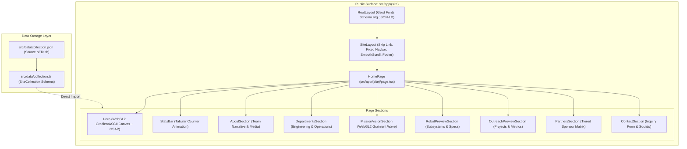
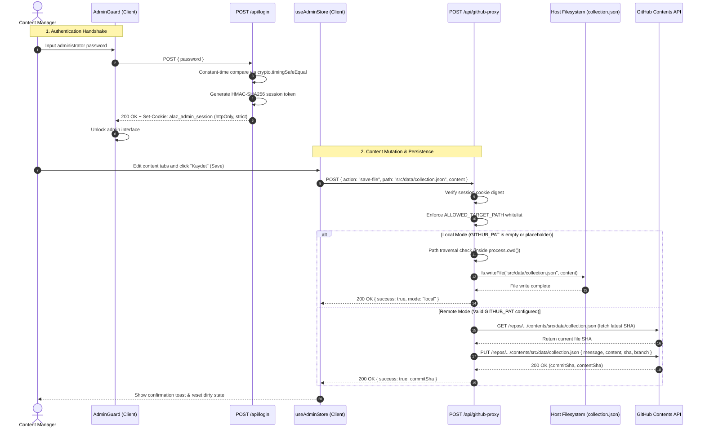

# TEAM ALAZ #12368

[](https://nextjs.org/)
[](https://react.dev/)
[](https://www.typescriptlang.org/)
[](https://tailwindcss.com/)
[](LICENSE)

Official web platform and headless Git-backed CMS for **Team ALAZ #12368**, a FIRST Robotics Competition (FRC) team based in Izmir, Turkey.

The application combines a high-performance, single-page landing site designed with an aerospace industrial brutalist aesthetic and a client-side administration panel that directly persists content updates into repository data files without requiring external database infrastructure.

---

## Architecture Overview

The system is built on Next.js 15 App Router and is partitioned into two isolated route trees:

1. **Public Site (`src/app/(site)`)**: High-performance landing page consuming structured data from `src/data/collection.json` via typed bindings in `src/data/collection.ts`. Features Lenis smooth scrolling, GSAP character-by-character reveals, and custom WebGL2 canvas backgrounds (`GradientASCII` and `Grainient`).
2. **Admin CMS (`src/app/admin`)**: Restricted single-page management dashboard wrapped by `AdminGuard` and driven by `useAdminStore`. Supports live section reordering, data mutation, dirty diff calculations, guided Driver.js walkthrough tours, and one-click data persistence.



---

## Admin CMS & Persistence Engine

The administration dashboard (`/admin`) manages all public content through a dual-mode persistence proxy (`/api/github-proxy`). Content administrators can edit strings, arrays, metrics, and media paths with changes validated against the `SiteCollection` interface.

### Dual-Mode Persistence Architecture

The API route detects the runtime environment via `GITHUB_PAT` and chooses one of two storage strategies:

- **Local Development Mode**: Activated when `GITHUB_PAT` is missing or matches the default placeholder string (`github_pat_your_token_here`). Updates are written directly to `src/data/collection.json` on the host machine using Node.js `fs/promises`.
- **Remote Production Mode**: Activated when a valid GitHub Personal Access Token is configured. Changes are converted to a Git commit via the GitHub Contents REST API (`PUT /repos/{owner}/{repo}/contents/{path}`), automatically committing updates to the target branch.



### Security & Hardening Controls

- **Timing-Safe Authentication**: Passwords and session tokens are evaluated using `crypto.timingSafeEqual` after length pre-validation to eliminate timing side-channel leakage.
- **Strict Target Whitelist**: The proxy route restricts file modifications strictly to `ALLOWED_TARGET_PATH = "src/data/collection.json"`. Requests targeting any other path fail immediately with HTTP 403 Forbidden.
- **Path Traversal Defense**: In local mode, paths are normalized and validated to ensure the resolved destination resides strictly within `process.cwd()`.
- **HTTP-Only Cookies**: Session tokens are isolated in `alaz_admin_session` cookies configured with `httpOnly: true`, `sameSite: "strict"`, and conditional production `secure` flags.

---

## Getting Started

### Prerequisites

- **Node.js**: Version 20.x or higher
- **pnpm**: Version 11.10.0+ (configured as the project's native package manager)

### Installation

Clone the repository and install dependencies using pnpm:

```bash
git clone https://github.com/cotanjant/teamalazfrc.git
cd teamalazfrc
pnpm install
```

### Environment Configuration

Copy the example environment configuration:

```bash
cp .env.example .env.local
```

Configure the environment variables according to your deployment mode:

| Variable | Required | Default | Description |
| :--- | :---: | :---: | :--- |
| `ADMIN_PASSWORD` | **Yes** | *None* | Shared master secret used for admin login verification and HMAC session token signing. |
| `GITHUB_PAT` | No | `github_pat_your_token_here` | GitHub Personal Access Token with repository `contents:write` permission. Required for remote commits. |
| `GITHUB_OWNER` | No | `cotanjant` | Target GitHub organization or user account hosting the repository. |
| `GITHUB_REPO` | No | `teamalazfrc` | Target GitHub repository name. |
| `GITHUB_BRANCH` | No | `main` | Target repository branch for CMS commits. |

> [!NOTE]
> If `GITHUB_PAT` is left blank or set to the default placeholder value, the application automatically runs in **Local Mode**, allowing you to test and mutate content locally without contacting the GitHub API.

---

## Development & Verification Commands

All standard development tasks are orchestrated via project scripts:

| Command | Action |
| :--- | :--- |
| `pnpm dev` | Starts the Next.js local development server at `http://localhost:3000`. |
| `pnpm build` | Executes TypeScript type checking and generates an optimized production build. |
| `pnpm start` | Boots the Next.js production server. |
| `pnpm lint` | Runs ESLint analysis across all project TypeScript and React components. |
| `pnpm dlx tsx src/lib/admin/__tests__/adminStore.test.ts` | Runs the test suite covering the Admin Store, dirty state tracking, and mutations. |
| `pnpm dlx tsx src/lib/i18n/__tests__/formattersAndI18n.test.ts` | Runs the test suite validating Turkish localization keys, formatting, and fallbacks. |

---

## Repository Structure

```
teamalazfrc/
├── .codegraph/                  # CodeGraph index database for structural code navigation
├── archive/                     # Historical media assets and Turkish reference documents
├── public/                      # Static web assets
│   └── medias/                  # High-resolution team and hero imagery (.webp and .jpg)
├── src/
│   ├── app/                     # Next.js 15 App Router directory
│   │   ├── (site)/              # Public landing page route group
│   │   │   ├── layout.tsx       # Public shell (Navbar, SmoothScroll, Footer)
│   │   │   └── page.tsx         # Landing page section composition
│   │   ├── admin/               # Internal Admin CMS dashboard
│   │   │   ├── layout.tsx       # AdminShellProvider, AdminGuard, AdminTour
│   │   │   └── page.tsx         # Tabbed admin editor interface
│   │   ├── api/                 # Backend Route Handlers
│   │   │   ├── github-proxy/    # Dual-mode content persistence endpoint
│   │   │   └── login/           # Constant-time auth & session management
│   │   ├── globals.css          # Tailwind CSS v4 setup and sharp geometry overrides
│   │   ├── layout.tsx           # Global HTML root layout with Schema.org JSON-LD
│   │   ├── robots.ts            # Dynamic robots.txt generation
│   │   └── sitemap.ts           # Dynamic sitemap.xml generation
│   ├── components/              # Shared React components
│   │   ├── admin/               # Admin CMS UI components, section forms, tour, and shell
│   │   ├── ui/                  # Radix UI primitive wrappers (Button, Card, Dialog, etc.)
│   │   ├── GradientASCII.tsx    # WebGL2 ASCII particle canvas for Hero
│   │   ├── Grainient.tsx        # WebGL2 dynamic wave canvas for Mission & Vision
│   │   ├── Navbar.tsx           # Fixed responsive navigation header
│   │   └── SmoothScroll.tsx     # Lenis smooth scroll and GSAP ScrollTrigger wiring
│   ├── data/                    # Structured data persistence layer
│   │   ├── collection.json      # Primary JSON database containing all site copy and items
│   │   └── collection.ts        # TypeScript interface contracts (SiteCollection)
│   ├── lib/                     # Application utilities and state management
│   │   ├── admin/               # useAdminStore, diff calculations, array reordering
│   │   └── i18n/                # Admin CMS translation helpers and formatters
│   └── locales/                 # Localization resources
│       └── admin/tr.json        # Turkish dictionary for Admin CMS labels and tours
├── .env.example                 # Template for required environment variables
├── components.json              # shadcn/ui configuration
├── next.config.mjs              # Next.js configuration
├── package.json                 # Project dependencies, scripts, and package manager specification
├── tsconfig.json                # TypeScript compiler configuration
└── LICENSE                      # MIT License
```

---

## Design System & Styling Rules

The visual identity is defined by an aerospace industrial design standard:

- **Sharp Geometry**: A global CSS rule enforces `border-radius: 0px !important` across all interactive elements, containers, and inputs. Soft, pill-shaped cards or buttons are strictly avoided.
- **Monochrome & Fire Accent Palette**:
  - Base: `#000000` (Ground) and `#0A0A0A` (Surface).
  - Typography: `#E8E8E8` (Ink) and `#666666` (Muted).
  - Accents: `#FF7800` (ALAZ Orange), `#FFD21C` (Warning Gold), and `#E83A0A` (Ember).
- **Interactive Tour System**: Powered by Driver.js (`src/components/admin/tour`), offering interactive guided onboarding for first-time administrators.
